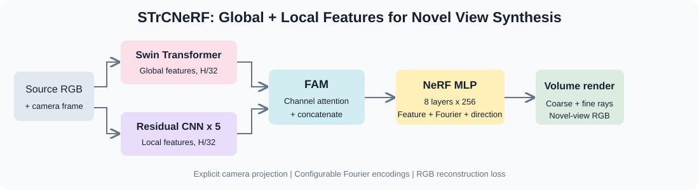

# STrCNeRF

## [Paper] STrCNeRF: An Implicit Neural Representation Method Combining Global and Local Features from an Image for Novel View Synthesis

A modular PyTorch implementation accompanying the paper by **Jubo Chen, Xiaosheng Yu, Xiaolei Tian, Junxiang Wang, and Chengdong Wu**, presented at the **2024 36th Chinese Control and Decision Conference (CCDC)**, pages 5119-5124.

[Paper](https://doi.org/10.1109/CCDC62350.2024.10587849) | [Dataset preparation](docs/DATASETS.md) | [Reproduction notes](docs/REPRODUCTION.md) | [Validation](docs/VALIDATION.md)

This is a paper-guided implementation with explicit assumptions where the publication does not uniquely determine executable behavior. No original author checkpoint or reproduced benchmark score is included. Repository presentation follows the research-code style of [SMCL](https://github.com/jubo-neu/SMCL).

## Graphical overview



## Highlights

- **Global and local features:** a Swin Transformer and a five-block residual CNN process the same source RGB image.
- **Feature Aggregation Module (FAM):** branch-specific channel attention reweights features before channel concatenation.
- **Fourier-conditioned NeRF:** configurable coordinate encoding conditions an eight-layer, 256-wide NeRF MLP in paper-scale presets.
- **Complete workflow:** dataset conversion, camera diagnostics, training, checkpoint resume, held-out view evaluation, and novel-view rendering.
- **Ablation support:** no encoding, basic Fourier, corrected complex Fourier, Gaussian random Fourier features, and disabled FAM.

STrCNeRF uses a single final-scale FAM. The implementation follows this paper's architecture and does not add FeRF's CSSAM or FFRM modules.

## Implementation status

- [x] Swin Transformer encoder, five residual CNN blocks and channel-attention FAM.
- [x] Image-conditioned coordinate MLP and coarse/fine volume rendering.
- [x] Training, checkpoint recovery, image evaluation and trajectory rendering.
- [x] NMR/ShapeNet interface, LLFF conversion and explicit camera manifests.
- [x] Encoding/FAM ablation runner and offline synthetic demonstration.
- [x] Unit tests and end-to-end CPU checks.
- [ ] Full NMR/LLFF training and paper-result replication.

**Fourier interpretation:** Eq. (13) prints subtraction in both exponential pairs. The cosine identity requires addition in the second pair. This project labels the corrected real-valued Euler interpretation as `complex`; it is mathematically equivalent to `basic` at identical frequency bands. The Gaussian mapping discussed in the ablation section is exposed separately. Its exact distribution/dimension are not specified by the paper and are documented implementation choices. We do not claim that rewriting sin/cos with Euler's formula alone increases representational capacity.

## Project structure

```text
STrCNeRF/
|-- train.py                      # Training entry point
|-- eval.py                       # Held-out image evaluation
|-- render.py                     # Camera trajectory rendering
|-- strcnerf/
|   |-- models/
|   |   |-- swin.py               # Native and optional timm Swin encoders
|   |   |-- cnn.py                # Five residual blocks with max pooling
|   |   |-- fam.py                # Channel-attention feature aggregation
|   |   |-- encoding.py           # Explicit Fourier variants
|   |   |-- field.py              # Coordinate-conditioned NeRF MLP
|   |   `-- network.py            # Encoders, FAM and source feature sampling
|   |-- rendering/
|   |   |-- camera.py             # OpenCV rays and feature projection
|   |   |-- sampling.py           # Coarse and PDF fine sampling
|   |   |-- volume.py             # Alpha compositing
|   |   `-- renderer.py           # Ray/image rendering
|   |-- data/                     # Scene archives, conversions, toy scenes
|   |-- engine.py                 # Training and evaluation loops
|   |-- checkpoint.py             # Model/optimizer/scaler/RNG recovery
|   |-- metrics.py                # PSNR, SSIM, optional LPIPS
|   `-- utils.py
|-- configs/                      # smoke, NMR and LLFF presets
|-- scripts/                      # Conversion, checking, ablations, smoke runs
|-- tests/
|-- docs/
`-- assets/
```

## Preparation for training

### 1. Environment

Python 3.10 or newer is required. Run commands from this repository's root directory.

```bash
python -m venv .venv
# Linux/macOS:
source .venv/bin/activate
# Windows PowerShell instead:
# .venv\Scripts\Activate.ps1
python -m pip install --upgrade pip

# Install a matching PyTorch / torchvision build for your CUDA version first.
pip install -e ".[pretrained,metrics,dev]"
```

For a CPU demonstration with no pretrained downloads:

```bash
pip install -e ".[dev]"
```

Alternatively, the supplied CUDA 12.1 Conda environment is a suggested GPU setup:

```bash
conda env create -f environment.yml
conda activate strcnerf
pip install -e .
```

The native Swin encoder is implemented locally and starts from random weights. `backbone: timm` supports ImageNet-pretrained Swin-T; first use with `pretrained: true` downloads weights. LPIPS separately needs its pretrained AlexNet weights. Loading a trained STrCNeRF checkpoint does not download Swin weights again.

### 2. Getting the data

The paper uses NMR ShapeNet views and real-world images processed with COLMAP and LLFF. Dataset files and pretrained STrCNeRF weights are not bundled. Obtain the original data and respect its terms.

Common archive structure:

```text
data/nmr/
|-- train/object_001.npz
|-- val/object_100.npz
`-- test/object_200.npz
```

Each `.npz` contains RGB `images [V,H,W,3]`, camera intrinsics `K [V,3,3]` (or shared `[3,3]`), and camera-to-world matrices `c2w [V,4,4]`. Cameras use OpenCV axes: right, down, forward. Intrinsics are in pixels at stored image resolution. Optional `source_indices` and `target_indices` define allowed view roles, preventing held-out LLFF images from becoming source inputs.

See [DATASETS.md](docs/DATASETS.md) for conversion commands, camera conventions, scene scale and split policies.

## Quick start

```bash
python scripts/make_demo_data.py --output data/demo --size 32
python -m pytest -q
python train.py --config configs/smoke.yaml --device cpu
python eval.py --checkpoint runs/smoke/latest.pt --output runs/smoke/eval --device cpu
python render.py --checkpoint runs/smoke/latest.pt --scene data/demo/test/test_000.npz --output runs/smoke/render --device cpu --gif
```

Or run `bash scripts/smoke_test.sh` on Linux/macOS or `powershell -ExecutionPolicy Bypass -File scripts/smoke_test.ps1` on Windows. The demonstration generates independent colored ellipsoid scenes for all three splits, trains for four steps, evaluates six held-out view pairs, and renders four camera views. Four steps verify execution and do not establish synthesis quality.

## Training

### NMR / ShapeNet

```bash
python train.py --config configs/nmr.yaml --device cuda
```

Use official **object-level** train/validation/test splits for generalization. Each step samples one source and a different target view from the selected training object. The NMR preset uses 64x64 images as a practical choice for common NMR exports; the paper does not give every dataset preprocessing detail.

### LLFF real-world scene

```bash
python scripts/prepare_data.py --format llff --input raw/fern --output data/llff/fern --size 128 --holdout 8
python scripts/check_dataset.py --root data/llff/fern --output runs/fern_camera_check
# Set near/far in configs/llff.yaml to cover the converted scene.
python train.py --config configs/llff.yaml --device cuda
```

LLFF conversion returns suggested source indices and scaled camera-depth bounds. Rendering uses normalized world-space rays and finite near/far bounds, without NDC warping. These bounds need visual confirmation; scene scale is not inferred. Default LLFF conversion uses the same held-out views for val/test; periodic validation is disabled in its preset. For hyperparameter selection, create separate validation and final-test view sets.

### Settings and outputs

The paper-scale presets use:

| Setting | Value |
|---|---|
| Encoder learning rate | `1e-5` |
| NeRF/FAM learning rate | `1e-4` |
| Adam | beta1 `0.9`, beta2 `0.999`, epsilon `1e-7` |
| Rays per image | `1024` |
| Coarse / additional fine samples | `64 / 128` |
| MLP trunk | 8 layers, 256 neurons per layer |
| Coordinate frequency bands | `10` for basic/complex modes |
| Training steps | `200000` |

The paper explicitly reports 200k iterations for its captured real scenes. Applying that count to NMR is a preset choice. FAM widths, skip connection, density activation, direction encoding and coarse/fine weight sharing are also choices; see [REPRODUCTION.md](docs/REPRODUCTION.md).

```bash
python train.py --config configs/nmr.yaml --data-root /path/to/nmr --output runs/my_nmr --device cuda
python train.py --config configs/nmr.yaml --resume runs/nmr/latest.pt --device cuda
```

`--steps` overrides the total target step count, including steps already completed. Resume checks core configuration compatibility and restores optimizer, scaler and random states. CUDA kernels can still vary across hardware or library versions.

```text
runs/nmr/
|-- config.json
|-- train.jsonl                   # Loss, ray PSNR, learning rate
|-- latest.pt                     # Atomic checkpoint
`-- validation/                  # Optional diagnostic image and metrics
```

If memory is insufficient, lower `rays_per_image` or `batch_size`, then `query_chunk`. Training retains field activations for backward, so query chunking does not eliminate total activation memory. `ray_chunk` controls full-image inference memory. AMP is optional and used only on CUDA. Record altered settings when comparing experiments.

## Test

```bash
python eval.py --checkpoint runs/nmr/latest.pt --split test --source-view 0 --output runs/nmr/eval --device cuda --lpips
python eval.py --checkpoint runs/llff_fern/latest.pt --split test --source-view 1 --output runs/llff_fern/eval --device cuda
```

Evaluation fixes the specified source for each scene and visits every allowed target except that source. For LLFF, source view 1 is usually allowed when holding out indices 0,8,16,...; check `conversion.json`. Full-image PSNR and SSIM are always computed; `--lpips` enables optional AlexNet LPIPS. Without it, LPIPS is omitted. The paper principally discusses PSNR; SSIM/LPIPS are additional convenience metrics, not a claim about its evaluation protocol.

Outputs include prediction/target PNGs and `metrics.json` with per-view, per-scene, mean-over-views and mean-over-scenes results. `--limit` is for debugging; omit it for full evaluation. SSIM uses an 11x11 Gaussian window, sigma 1.5, valid convolution, RGB range `[0,1]`. LPIPS receives RGB in `[-1,1]`.

## Novel-view rendering

```bash
python render.py --checkpoint runs/nmr/latest.pt --scene data/nmr/test/object_200.npz --source-view 0 --output runs/nmr/render --device cuda --gif
```

Add `--trajectory trajectory.npz` to render custom cameras. It must contain `c2w [T,4,4]` and optional `K [T,3,3]` or shared `[3,3]`, in the source scene's world frame and scale. Rendering uses checkpoint image resolution. Outputs include RGB frames, optional GIF, and raw depth/opacity arrays. Depth is `sum(weights * ray_distance)`, unnormalized by opacity; empty rays therefore have zero depth.

## Ablation studies

```bash
python scripts/run_ablation.py --config configs/llff.yaml --source-view 1 --device cuda --output runs/fern_ablation --variants none basic complex gauss_5 gauss_10 gauss_15 no_fam
```

For a short pipeline check, use `--config configs/smoke.yaml --steps 2 --device cpu --source-view 0`. Each variant receives the same configured seed and training budget, trains independently and exports test metrics plus a combined `summary.json`. Changing input dimensionality changes parameter initialization draws, so this is not a guarantee of identical initial shared tensors across every encoding variant. `basic` and corrected `complex` are mathematically identical and should agree under identical seeds/settings. `no_fam` bypasses channel attention while preserving the feature dimensions.

Gaussian encoding uses fixed `B ~ Normal(0, sigma^2)` and `[sin(2*pi*x*B^T), cos(2*pi*x*B^T)]`, 64 random features by default. It does not imply that the paper disclosed this exact mapping or achieved its reported ablation curves under this implementation.

## Results and reproducibility

See [VALIDATION.md](docs/VALIDATION.md) for checks performed on this release. No full-scale NMR/LLFF training, publication-speed verification, or published-score reproduction has been performed. Camera calibration and target camera parameters are required; the system does not estimate poses from a single arbitrary photograph.

## Citation

```bibtex
@inproceedings{chen2024strcnerf,
  title={STrCNeRF: An Implicit Neural Representation Method Combining Global and Local Features from an Image for Novel View Synthesis},
  author={Chen, Jubo and Yu, Xiaosheng and Tian, Xiaolei and Wang, Junxiang and Wu, Chengdong},
  booktitle={2024 36th Chinese Control and Decision Conference (CCDC)},
  pages={5119--5124},
  year={2024},
  doi={10.1109/CCDC62350.2024.10587849}
}
```

## Acknowledgements

The architecture follows the STrCNeRF publication and the published ideas of Swin Transformer, residual CNNs, channel attention, Fourier features and NeRF. README organization references [SMCL](https://github.com/jubo-neu/SMCL). No SMCL source implementation, paper figure, or original author checkpoint is redistributed.
